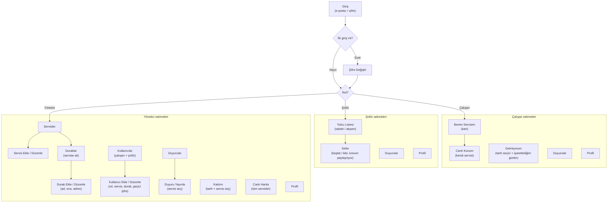
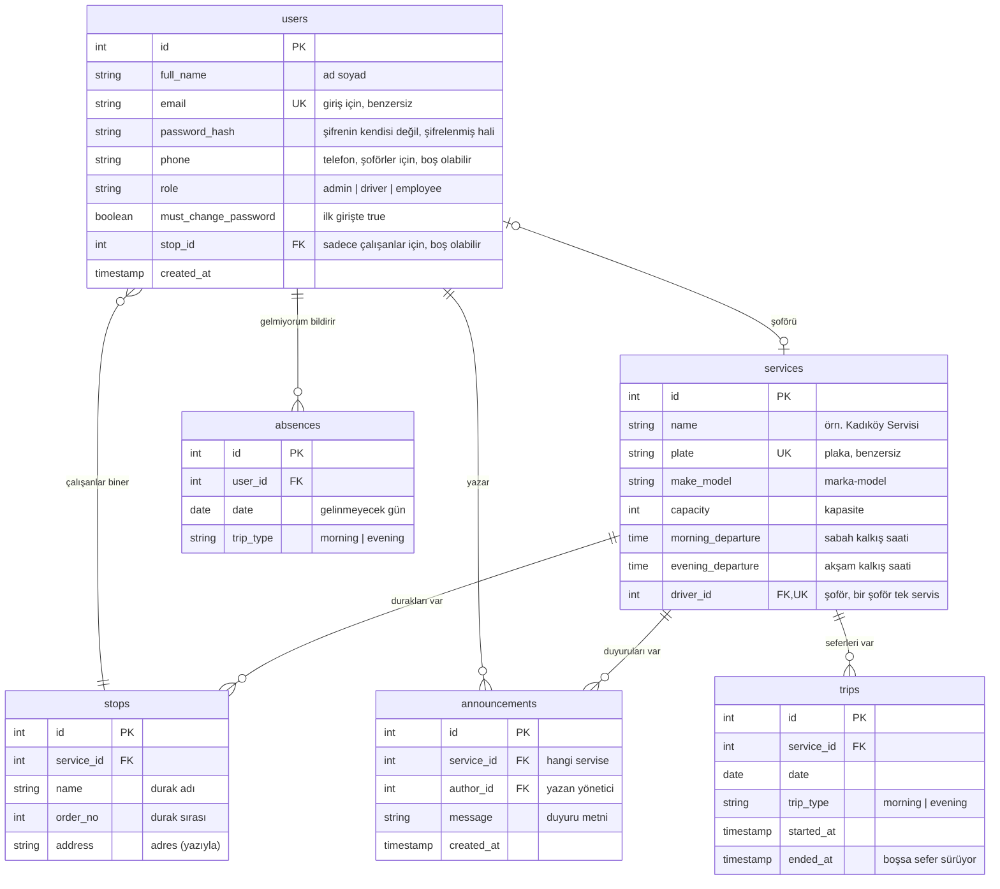

# servis-app

## 1. Amaç
Şirkette servisler bir WhatsApp grubu üzerinden yönetiliyor. Saat, durak ya da şoför değiştiğinde bu bilgi mesajların arasında kayboluyor. Kimin neyi bildiği belli olmuyor ve karışıklık çıkıyor.

servis-app, servis bilgisi için **tek doğru bilgi kaynağı** olacak bir mobil uygulama. Her çalışan kendi servisinin güncel bilgisini uygulamada görür, değişiklikler duyuru olarak iletilir.

Bu proje öğrenme amaçlı kişisel bir proje. Gerçek şirket verisi kullanılmıyor, **demo verilerle** çalışılacak.

## 2. Kullanıcı Rolleri
- **Yönetici:** Servisleri, durakları ve çalışanları yönetir. Değişiklikleri duyurur, tüm servisleri takip eder.
- **Şoför:** Seferi başlatıp bitirir, o günkü yolcu listesini görür. Sefer sırasında konumu paylaşılır.
- **Çalışan:** Kendi servisinin bilgilerini ve duyuruları görür, gelmeyeceği günleri bildirir.

## 3. MVP Özellikleri

### Yönetici
- Servis ekleme, düzenleme, silme (ad, plaka, marka-model, şoför, kapasite, sabah/akşam kalkış saatleri)
- Servise durak ekleme (ad, sıra, adres)
- Çalışan ekleme (geçici şifreyle) ve servise/durağa atama
- Bir servise değişiklik duyurusu yayınlama (sadece o servisin çalışanlarına ve şoförüne gider)
- Günlük katılım listesi (kim geliyor, kim gelmiyor)
- Tüm servislerin canlı konumunu haritada görme

### Çalışan
- "Benim servisim" kartı: servis adı, plaka, marka-model, durak, kalkış saati, şoför adı ve telefonu
- "Gelmiyorum" bildirimi: tarih seçiciyle bir veya birden fazla gün seçilir, her gün için sabah, akşam ya da ikisi işaretlenir. Bildirim geri alınabilir.
- Kendi servisiyle ilgili duyuruları görme
- Kendi servisinin canlı konumunu haritada görme

### Şoför
- Günlük yolcu listesi (durak sırasına göre, gelmeyenler işaretli)
- Sefer başlatma ve bitirme
- Sefer sırasında konum paylaşımı
- Kendi servisiyle ilgili duyuruları görme

### Canlı konum kuralları
- Canlı konumun asıl amacı çalışanların işini kolaylaştırmak: servisin nerede olduğunu görüp durağa ona göre çıkmak. Yönetici de tüm servisleri görür.
- Konum sadece sefer başlatıldığında paylaşılır, sefer bitince durur (KVKK ve pil tasarrufu).
- Şoför uygulaması ekranda açık olmalı. Arka planda konum paylaşımı sonraki sürüme kaldı.
- Konum 5-10 saniyede bir gönderilir.
- Çalışan sadece kendi servisini, yönetici tüm servisleri görür.

## 4. Sonraki Sürümler
- Push bildirim (duyuru gelince telefona bildirim)
- Arka planda konum paylaşımı
- Biniş yoklaması (şoför, binen çalışanı işaretler)
- Raporlar
- Değişiklik geçmişi
- Ayrı web yönetici paneli
- Birden fazla şirket desteği

## 5. Teknoloji
| Katman | Seçim | Neden |
|---|---|---|
| Mobil | React Native + Expo (TypeScript) | Tek dille (TypeScript) mobil, backend ve ileride web paneli yazılabilir. |
| Backend | Node.js + TypeScript | Mobil ile aynı dil, öğrenme yükü azalır. |
| Veritabanı | PostgreSQL | İlişkili veriler (servis, durak, çalışan) için uygun, yaygın ve ücretsiz. |
| Canlı konum | WebSocket (Socket.IO) | Konumu sürekli sormak yerine sunucu anlık olarak iletir. |
| Harita | Leaflet + OpenStreetMap (telefonda react-native-webview içinde) | Anahtar gerektirmiyor, Expo Go'da çalışıyor, web ve telefon aynı haritayı gösteriyor. react-native-maps denendi ama Expo Go'da Google haritası yüklenmedi. Yayına alırken ücretli bir karo sağlayıcısı gerekecek. |

## 6. Aşamalar
Her aşamanın sonunda telefonda çalışan bir şey olacak. Her özellik uçtan uca (ekran → backend → veritabanı) bitirilip sonrakine geçilecek.

0. **Plan ve kurulum:** Plan yazılır, ekran listesi ve veri modeli çıkarılır. Node.js, Git, PostgreSQL ve telefona Expo Go kurulur.
1. **Temelleri tanıma:** Kısa TypeScript alıştırması. Boş Expo uygulaması telefonda, boş backend tarayıcıda çalışır.
2. **Veritabanı ve demo veri:** Tablolar oluşturulur, seed ile demo veri doldurulur.
3. **Giriş sistemi:** E-posta + şifre ile giriş, ilk girişte şifre değiştirme, role göre farklı ana ekran.
4. **"Benim servisim" kartı:** İlk uçtan uca özellik (sadece okuma).
5. **Yönetici işlemleri:** Servis, durak ve çalışan ekleme/düzenleme/silme, atama.
6. **Katılım:** "Gelmiyorum" (tarih seçicili), şoför yolcu listesi, yönetici katılım listesi.
7. **Duyurular:** Yöneticinin servise duyuru yayınlaması, çalışanın ve şoförün görmesi.
8. **Canlı konum:** Sefer başlat/bitir, Socket.IO ile konum iletimi, harita.
9. **Toparlama:** Hata düzeltme, görünüm iyileştirme, backend'i internete koyma.

## 7. Kararlar
- **Giriş:** Şirketin verdiği e-posta + şifre. Yönetici çalışanı geçici şifreyle ekler, ilk girişte şifre değiştirilir. İlk yönetici veritabanına seed ile eklenir.
- **Yönetici paneli:** Mobil uygulamanın içinde, giriş yapan kişinin rolüne göre ekranlar değişir.
- **Tek şirket** desteklenir.
- **Demo veri:** 3 servis, servis başına 4-5 durak, 20-30 çalışan. Her servisin sabah ve akşam seferi var.
- **Şoför girişi:** Şoföre de yönetici tarafından e-posta + şifre verilir, çalışanlarla aynı şekilde giriş yapar.
- **Gelmiyorum bildirimi:** Saat sınırı yok. Tarih seçiciyle ileri bir gün (veya izin gibi birden fazla gün) işaretlenebilir.
- **Duyurular:** Sadece ilgili servisin çalışanlarına ve şoförüne gider. Kimin gördüğü takip edilmez.
- **Şoför ataması:** Her servisin tek, sabit bir şoförü var. Şoför değişirse yönetici servisi düzenler. Gerekirse ileride değiştirilir.
- **Roller:** Kullanıcının rolü (yönetici, şoför, çalışan) sadece eklenirken seçilir, sonradan değiştirilemez. Birden fazla yönetici olabilir. Sistemde her zaman en az bir yönetici bulunur (yönetici kendini silemez).
- **Durak konumu:** Duraklar harita konumuyla değil, yöneticinin yazdığı adresle tutulur. Şoför yolları zaten biliyor, haritadan konum seçtirmek gereksiz uğraş olur.
- **Konum geçmişi:** Saklanmaz. Sadece anlık konum iletilir, sefer bitince silinir.

## 8. Açık Sorular
(Şu an yok)

## 9. Ekranlar
Uygulama açılınca giriş ekranı gelir. Giriş yapan kişinin rolüne göre farklı bir ana ekran açılır. Her rolün ekranları alttaki sekme çubuğundan (tab bar) gezilir.

### Ekran akışı

### Ekran listesi
| Rol | Ekran | Ne işe yarar |
|---|---|---|
| Ortak | Giriş | E-posta ve şifreyle giriş. |
| Ortak | Şifre Değiştir | İlk girişte geçici şifre değiştirilir. Profilden de açılabilir. |
| Ortak | Profil | Ad, e-posta, şifre değiştirme, çıkış yap. |
| Çalışan | Benim Servisim | Servis adı, plaka, marka-model, durak, kalkış saati, şoför adı ve telefonu (dokununca arama açılır). Sefer başlamışsa "Canlı konumu gör" butonu. |
| Çalışan | Canlı Konum | Kendi servisinin haritadaki anlık konumu. |
| Çalışan | Gelmiyorum | Tarih seçiciyle gün(ler) ve sabah/akşam seçimi. Altında işaretlenmiş günler, her birinin yanında "Geri al". |
| Çalışan, Şoför | Duyurular | Kendi servisine yayınlanan duyurular, en yenisi üstte. |
| Şoför | Yolcu Listesi | Seçilen sefer (sabah/akşam) için durak sırasına göre yolcular, gelmeyenler işaretli. "Seferi başlat" butonu. |
| Şoför | Sefer | Sefer sürerken açık kalan ekran. Konum paylaşıldığını gösterir, "Seferi bitir" butonu. |
| Yönetici | Servisler | Tüm servislerin listesi. |
| Yönetici | Servis Ekle / Düzenle | Ad, plaka, marka-model, şoför, kapasite, sabah/akşam kalkış saati. Silme de buradan. |
| Yönetici | Duraklar | Bir servisin durakları, sıralı. |
| Yönetici | Durak Ekle / Düzenle | Durak adı, sırası, adresi (yazıyla). |
| Yönetici | Kullanıcılar | Tüm çalışanlar ve şoförler, role göre filtrelenebilir. |
| Yönetici | Kullanıcı Ekle / Düzenle | Ad, e-posta, telefon, rol, geçici şifre. Çalışansa servis ve durak ataması. |
| Yönetici | Duyurular | Yayınlanan duyuruların listesi. |
| Yönetici | Duyuru Yayınla | Servis seçilir, duyuru metni yazılır. |
| Yönetici | Katılım | Seçilen gün ve servis için gelen/gelmeyen listesi. |
| Yönetici | Canlı Harita | Seferde olan tüm servislerin anlık konumu. |

## 10. Veri Modeli
Tablo ve sütun adları İngilizce (kodda yaygın kullanım, Türkçe karakter sorunu olmaz). Açıklamalar Türkçe. Bu model onaylandı.

### ER diyagramı

### Tablolar
| Tablo | Ne tutar |
|---|---|
| `users` | Tüm kullanıcılar: yönetici, şoför, çalışan. Rol sütunu hangisi olduğunu söyler. |
| `services` | Servisler ve bilgileri. Her servisin bir şoförü var. |
| `stops` | Duraklar. Her durak bir servise ait. |
| `absences` | "Gelmiyorum" bildirimleri. Her satır = bir kişi, bir gün, bir sefer. |
| `announcements` | Duyurular. Her duyuru bir servise ait. |
| `trips` | Başlatılan seferler. Şu an süren seferi bulmak için kullanılır. |

### Tasarım kararları
- **Çalışanın servisi, durağından bulunur.** `users` tablosunda sadece `stop_id` var, `service_id` yok. Durak zaten bir servise ait olduğu için servis oradan bulunur. İkisini birden tutsaydık "durağı A servisinde ama servisi B" gibi tutarsız bir kayıt oluşabilirdi.
- **Gelmeme bildirimi satır satır tutulur.** "Sabah ve akşam" seçilirse iki satır eklenir. Birden fazla gün seçilirse her gün için ayrı satır eklenir. "Geri al" o satırı siler. Bir kişinin bir gün ve bir sefer için birden fazla satırı olamaz (`user_id + date + trip_type` benzersiz).
- **Gelenler ayrıca tutulmaz.** Bir servisin çalışanlarından `absences` tablosunda kaydı olmayanlar gelecek kabul edilir. Katılım listesi ve şoförün yolcu listesi böyle çıkarılır.
- **Canlı konum veritabanına yazılmaz.** Şoförün telefonundan gelen konum, sunucu üzerinden doğrudan çalışanlara iletilir (Socket.IO). Konum geçmişi saklanmadığı için tabloya gerek yok.
- **Şifre düz metin olarak saklanmaz.** Sadece şifrelenmiş hali (hash) tutulur. Veritabanı ele geçirilse bile şifreler okunamaz.
